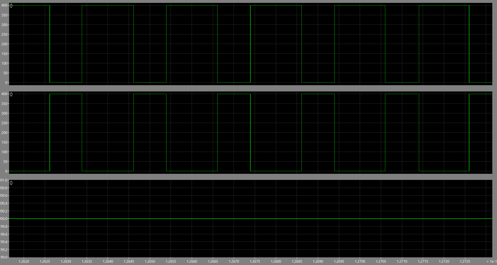
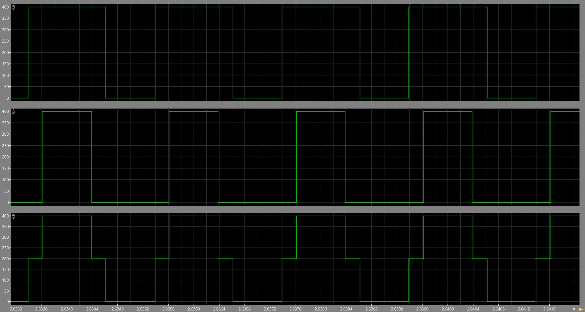
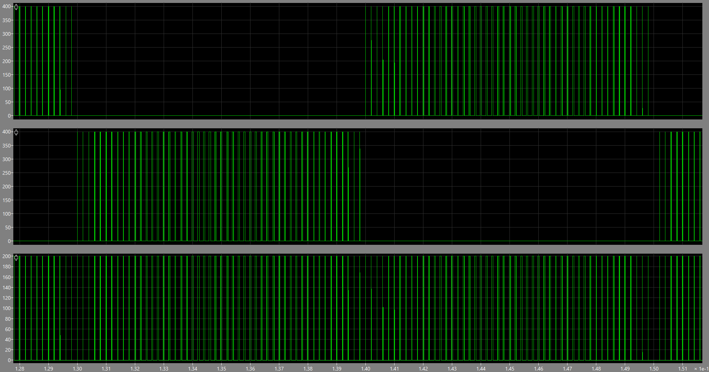

# H4 vs H5 Transformerless Inverter — Common-Mode Voltage and Leakage Current

PLECS simulation study comparing a single-phase full-bridge (H4) inverter under **bipolar** and **unipolar** PWM with the **H5** transformerless topology. The focus is common-mode voltage (CMV), ground leakage current, output current ripple, and EMI trade-offs in transformerless PV inverters.

Course project — *Control of Energy Conversion Systems*, Warsaw University of Technology, 2026.

## Why it matters

Transformerless PV inverters are cheaper, smaller and more efficient, but they lose galvanic isolation. The parasitic capacitance between the PV panel and ground then becomes a path for leakage current, driven by changes in common-mode voltage:

$$V_{cm} = \frac{V_a + V_b}{2} \qquad I_{leakage} = C_p \frac{dV_{cm}}{dt}$$

The choice of PWM strategy and topology decides how much CMV fluctuates, so it decides how much leakage current flows.

## Simulation setup

| Parameter | Value |
|---|---|
| DC link voltage | 400 V |
| Filter inductance L | 2 mH |
| Load resistance R | 5 Ω |
| Load capacitance C | 50 µF |
| Parasitic capacitance Cp | 100 pF |
| Parasitic resistance Rp | 10 kΩ |
| Reference (output) frequency | 50 Hz |
| Carrier (switching) frequency | 5 kHz |

Configurations simulated:
1. H4 full bridge, bipolar PWM
2. H4 full bridge, unipolar PWM
3. H5 topology (extra switch on the positive DC rail that decouples the DC source during freewheeling)

## Results

| Configuration | CMV behaviour | dVcm/dt | Output current ripple | Leakage current |
|---|---|---|---|---|
| H4 bipolar | Constant 200 V | ~0 | High (~18 A) | Near zero |
| H4 unipolar | Rail-to-rail swing 0–400 V | Very high | Low (~3.5 A) | High |
| H5 | Square wave 0–200 V | Medium | Low (~8 A) | Suppressed, flows only half the period |

**Common-mode voltage (Node A, Node B, Vcm):**

| Bipolar H4 | Unipolar H4 | H5 |
|---|---|---|
|  |  |  |

**Takeaways**
- **Bipolar PWM** keeps CMV flat, so leakage is minimal, but the ±400 V output swing gives large current ripple and needs bigger filter inductors.
- **Unipolar PWM** gives a three-level output and low ripple, but CMV jumps between 0 V and 400 V at switching frequency, which drives high leakage current and EMI.
- **H5** keeps the three-level, low-ripple output of unipolar PWM, while the fifth switch isolates the DC link during freewheeling. That limits CMV swing and suppresses leakage current, so you get the advantages of both.

## Repository files

| File | Content |
|---|---|
| `H4_bipolar_PWM.plecs` | H4 full bridge, bipolar PWM |
| `H4_unipolar_PWM.plecs` | H4 full bridge, unipolar PWM |
| `H5_inverter.plecs` | H5 transformerless topology |
| [`H4_H5_CMV_report.pdf`](H4_H5_CMV_report.pdf) | Full report with all waveforms and FFT spectra |
| `cmv_*.png` | Figures used in this README |

## How to run

1. Open the `.plecs` files in **PLECS Standalone 4.9** or later.
2. Run the simulation. Scopes show the Node A / Node B voltages, Vcm, output voltage and current, and leakage current.
3. Use the PLECS scope FFT view to reproduce the CMV frequency spectra.

The models contain an extra load switch that was used only to study switching behaviour. It is not part of the results above.

## Key challenge

Published papers don't state the gate-signal logic for the H5 fifth switch (S5) explicitly, so I derived it from the modulation signals of the four bridge switches. Leakage current isn't a real component of the ideal circuit, so I modelled it by adding the parasitic Cp/Rp path to ground, following reference [1].

## Tools

PLECS · PWM modulation · Power electronics · FFT analysis

## References

1. A. Daibagna, *Design of H5 Transformerless Inverter for Photovoltaic System*, IOP Conf. Series: Materials Science and Engineering 1295, 012016. [Link](https://iopscience.iop.org/article/10.1088/1757-899X/1295/1/012016/pdf)
2. Laboratory materials, Control of Energy Conversion Systems, WUT.

## Author

**Nurmukhammed Polat** — Electrical Engineering, Warsaw University of Technology
[LinkedIn](https://www.linkedin.com/in/nurmukhammed-polat-6a6677251/)
